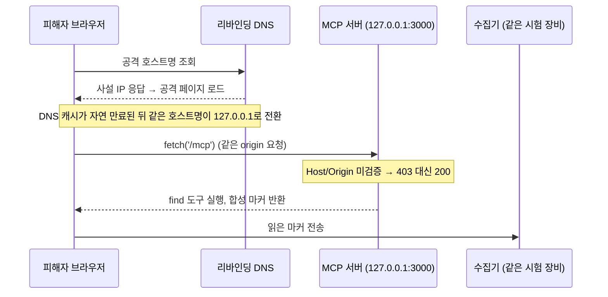

# mongodb-mcp-server: untrusted Host/Origin on the HTTP transport (GHSA-956r-x8xm-h433)

공식 npm `mongodb-mcp-server@3.2.2`가 `--transport http`로 루프백에 바인딩하면서도 요청 Host/Origin을 검증하지 않아, 사설 주소 페이지가 DNS 리바인딩으로 루프백 MCP 서버에 도달해 DB 데이터를 읽을 수 있는 결함 분석(실험은 합성 DB에 심은 마커로 확인).


| | |
|---|---|
| Package | `mongodb-mcp-server` (npm) |
| Affected | 3.2.2에서 확인 (3.3.0에서도 해당 코드 변경 없음) |
| Advisory | GHSA-956r-x8xm-h433 (비공개, 유지관리자 Closed · 제보 시 잠정 Moderate, CWE-346) |
| Status | 벤더 Closed, 미패치 (2026-11-14 소스 대조 기준) |

## 한눈에

내 컴퓨터에서 로컬로 돌아가는 MongoDB 보조 서버(MCP)는 "외부에선 못 붙으니 안전하다"고 여겨진다. 하지만 사설 주소에서 서빙되는 공격 페이지를 내가 브라우저로 열면, 그 페이지가 **DNS 속임수로 자기 주소를 내 컴퓨터(127.0.0.1)로 둔갑**시켜 내 브라우저가 **내 자신의 로컬 서버**를 몰래 읽게 만들어 DB 데이터(실험에서는 심어 둔 마커)를 빼낼 수 있다. 서버가 "이 요청이 어디서 왔지?"(Host/Origin)를 검사하지 않기 때문이다. 실제 브라우저(Chrome)로 재현했고, 한계(기본은 안전한 stdio 전송·공용 인터넷 출처는 미입증)까지 밝힌다.

## 요약

`--transport http`는 문서상 기본값 `127.0.0.1:3000`에 바인딩하지만, 외부 Host/Origin을 실은 MCP 요청도 처리한다. 스펙은 잘못된 Origin에 403을 요구하지만 네 가지 Host/Origin 조합 모두 `initialize` 요청에 200을 반환한다. 외부 Host+Origin 조합에서는 legacy·2026-07-28 두 경로 모두 `find` 등 도구를 실행해 심어둔 마커를 반환한다. 통제된 Chrome 156 실험에서, 사설 주소에서 서빙된 페이지가 자연 DNS 캐시 만료로 루프백에 도달해 마커를 읽어 수집기로 보냈다. 기본 전송은 stdio이고, 영향은 헤더 가드 없는 opt-in HTTP 전송에 한정된다. 공용 인터넷 출처 공격은 미입증.



*루프백 바인딩만으로는 요청 단위 Host/Origin 검증을 대체하지 못한다. 공용 인터넷 출처는 미입증.*

## 근본 원인

`--transport http` 경로는 바인드 주소만 검사하고 요청 Host/Origin은 검사하지 않는다(3.2.2, 소스 `e17fda3` 기준. 아래 세 파일은 3.3.0에서도 바뀌지 않았다).

- `packages/http-runners/src/expressBasedHttpServer.ts` `checkHttpHost()` (~31–49) — 바인드 host가 루프백인지만 확인
- `packages/http-runners/src/mcpHttpServer.ts` (~163, ~204–234) — CLI 경로의 미들웨어 훅이 비어 있고 선택적 `httpHeaders` 검증만 수행(기본 `{}`)
- `packages/http-runners/src/legacyMcpHttpHandler.ts` (~326) — `NodeStreamableHTTPServerTransport`를 allowedHosts/allowedOrigins 없이 생성

MCP Streamable HTTP 스펙은 present-but-invalid Origin에 403을 요구한다. 루프백 바인딩과 `0.0.0.0` 거부만으로는 이 요청 단위 검사를 대체하지 못한다.

## 검증

미수정 published 3.2.2 대상. 경계 행렬 4/4(loopback/foreign Host × absent/foreign Origin) 모두 `initialize`에 200. 마커 반환은 foreign Host + foreign Origin 조합의 legacy·modern 두 경로에서 확인. 실브라우저: 사설 IP에서 서빙된 페이지가 DNS 응답을 루프백으로 전환 → headed Chrome 156 요청 20회째, headless 40회째에 마커 수집(각 1회 실행, LNA 비활성 플래그·수동 캐시 삭제 없이). 공격 페이지·수집기·MCP 서버는 한 시험 장비에서 실행했다. 공용 인터넷 출처는 Chrome public-address 제어가 차단해 미입증. 실제 데이터는 접근하지 않았다.

## 재현 (결함 확인)

루프백에 접근 가능한 로컬에서, 외부 Host/Origin으로도 200을 주는지 확인:

```bash
curl --noproxy '*' -si http://127.0.0.1:3000/mcp \
  -H 'Host: attacker.example:3000' -H 'Origin: http://attacker.example:3000' \
  -H 'Accept: application/json, text/event-stream' -H 'Content-Type: application/json' \
  --data '{"jsonrpc":"2.0","id":1,"method":"initialize","params":{"protocolVersion":"2025-03-26","capabilities":{},"clientInfo":{"name":"probe","version":"1"}}}'
# 기대: 403 (invalid Origin) / 실제: 200
```

브라우저로 원격 전달하는 DNS 리바인딩 수집기는 공개하지 않는다.

## 선행 CVE와의 차이

`DBHub CVE-2026-61742`, `GenieACS MCP CVE-2026-55637`은 리바인딩 이후 요청을 HTTP 클라이언트로 구성해 확인했다. 본 건은 사설 주소 출처에서 실제 Chrome의 자연 캐시 만료로 루프백 도달까지 재현하고 범위를 한정했다.

## 완화 / 후보 수정

- 가능하면 HTTP 전송 대신 기본 stdio 사용
- HTTP가 필요하면 `MDB_MCP_HTTP_HEADERS`로 비밀 헤더 가드(토큰 없는 요청은 403 확인) 또는 Host/Origin을 검증하는 인증 프록시 뒤에 배치
- 유지관리자: 전송 생성 시 allowedHosts/allowedOrigins 지정, 또는 라우팅 전 Host/Origin 검증 후 403

## 디스클로저

`GHSA-956r-x8xm-h433`로 비공개 제보. 벤더가 기술적 반박 없이 Closed했고 패치는 발행되지 않았다(3.3.0에서도 해당 코드 변경 없음, 2026-11-14 확인). 조율 대응이 종료되어, 영향 사용자가 스스로 완화할 수 있도록 근본 원인과 완화책을 공개한다. 미패치라 턴키 러너는 비공개.

## License

MIT (`LICENSE`).
